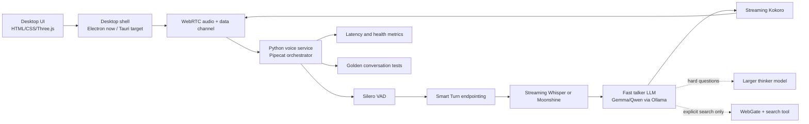

# Talking Buddy desktop architecture

This is the production architecture for the desktop voice companion. Pipecat/WebRTC is now the configured primary path on `codex/desktop-v1`; the current `server.py` WebSocket route remains the validated compatibility fallback during migration.

## Runtime topology

## Responsibilities

- `desktop/`: native window lifecycle, Python sidecar startup, settings bridge, and future packaging.
- `static/`: avatar scene and UI. It must not own model orchestration or provider credentials.
- `server/` (target): Pipecat bot, processors, provider adapters, preflight, tools, and health endpoints.
- `server.py`: current compatibility server; remove only after the Pipecat route passes the regression suite.
- `scripts/`: model selection, dependency checks, packaging, and release helpers.
- `tests/`: unit tests, latency probes, and replayable golden conversations.
- `docs/`: architecture decisions, pipeline contracts, and release notes.

## Pipeline contract

The orchestration layer owns turn state and cancellation. The Pipecat path uses its segmented STT service contract around the project-owned MLX Whisper adapter; Pipecat owns VAD boundaries, buffering, cancellation, and transcription-frame delivery. The compatibility WebSocket path still provides rolling partial Whisper captions. Providers implement narrow interfaces for STT, LLM, TTS, VAD/turn detection, and transport. Every provider must support health checking, cancellation, and timing events. Audio is never logged by default.

The assistant keeps listening while speaking. VAD detects speech, Smart Turn decides whether a turn is complete, and a real interruption cancels queued LLM/TTS work. The assistant transcript is committed only for audio that was actually delivered to the user.

## Desktop packaging

During development Electron launches the local service. The production target is a lightweight Tauri shell with a platform-specific Python sidecar. PyInstaller builds the sidecar separately on macOS and Windows. Ollama and large model weights remain managed dependencies downloaded by the in-app setup screen rather than embedded in the installer.

## Delivery phases

1. Freeze provider contracts and add health/preflight reporting. **Complete.**
2. Validate the supplied Pipecat starter against the pinned Pipecat version. **Complete against Pipecat 1.15.0.**
3. Run Pipecat with its built-in WebRTC client before connecting the avatar. **Complete: signaling and worker startup validated.**
4. Connect the avatar bridge, audio analyser, transcript events, and interruption hooks.
5. Add latency probes and golden conversation replay gates.
6. Add SQLite summaries/memory only after the core loop is stable.
7. Package the Python sidecar and move the shell from Electron to Tauri.
8. Produce signed macOS and Windows installers and test on clean machines.

## Non-goals for this architecture step

No model migration, avatar redesign, database memory, or installer packaging is being performed on this branch yet. Those changes follow the phases above and must be validated independently.
